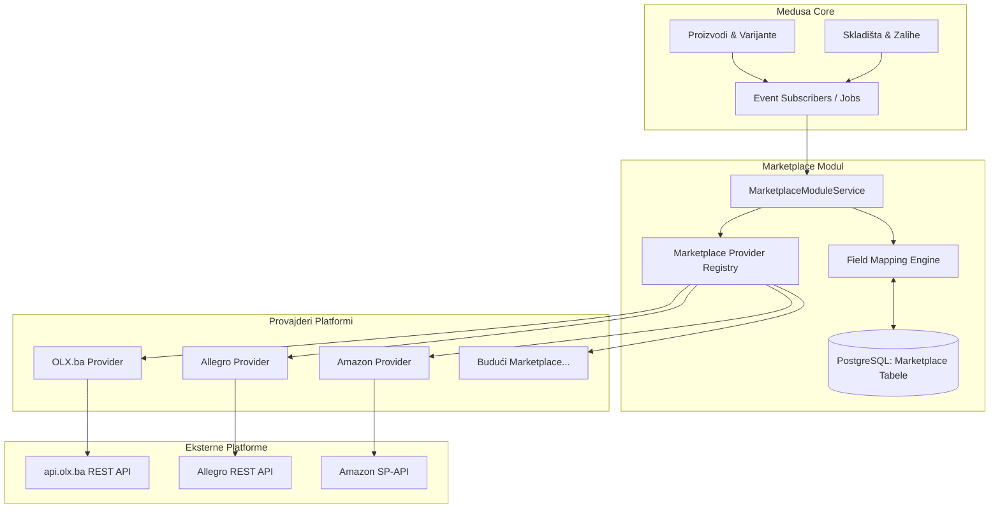
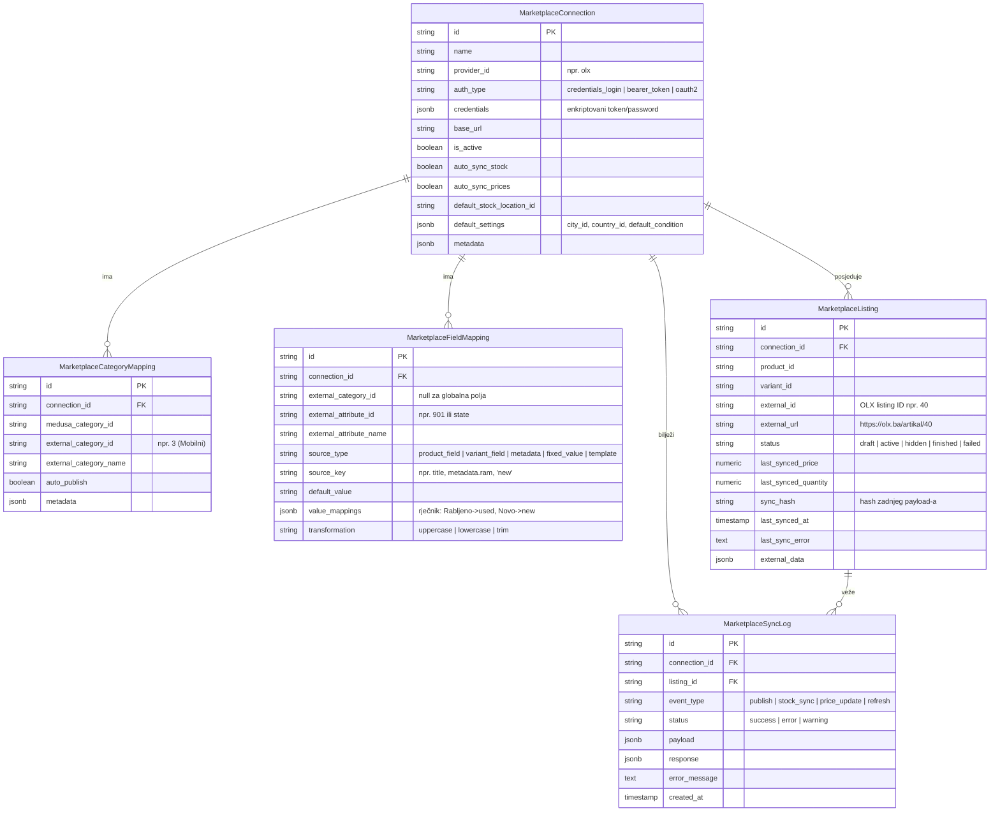
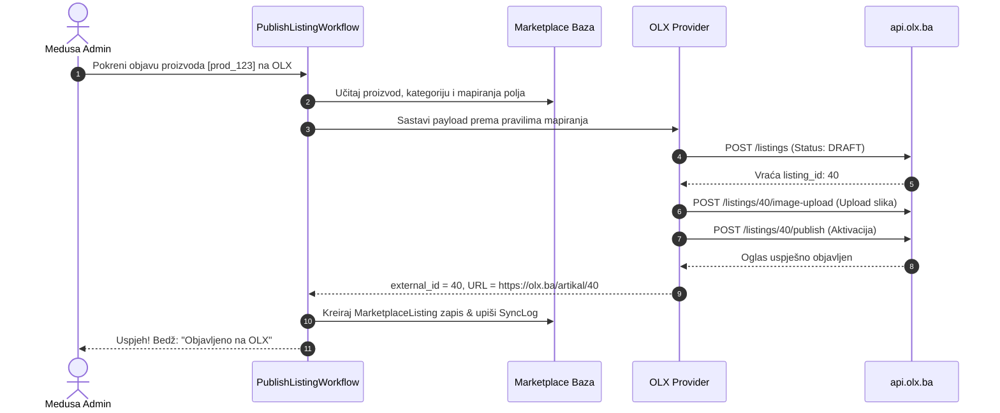
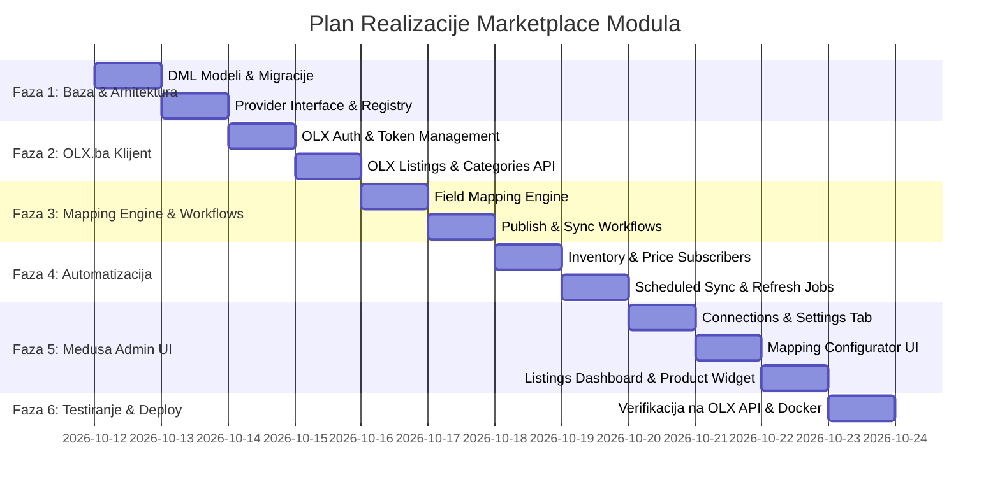

# 🌐 Plan Implementacije: Modularni Sistem za Integraciju Eksternih Marketplace-ova
### MedusaJS v2 — Proširiva "Multi-Channel Marketplace" Arhitektura & OLX.ba Integracija

Ovaj dokument definira cjelokupni plan arhitekture, baze podataka, radnih tokova (workflows), mehanizma mapiranja i korisničkog interfejsa za povezivanje Medusa v2 prodavnice sa eksternim oglasnicima i marketplace platformama (poput **OLX.ba**, **Allegro**, **eMag**, **Amazon**, **Ananas**, itd.).

---

## 📑 Sadržaj
1. [Arhitektura & Proširivost (Provider Pattern)](#1-arhitektura--proširivost-provider-pattern)
2. [Analiza OLX.ba API-ja (Pilot Integracija)](#2-analiza-olxba-api-ja-pilot-integracija)
3. [DML Modeli Podataka (PostgreSQL Shema)](#3-dml-modeli-podataka-postgresql-shema)
4. [Interfejs Provajdera (TypeScript Specifikacija)](#4-interfejs-provajdera-typescript-specifikacija)
5. [Dinamički Mehanizam Mapiranja Polja (Mapping Engine)](#5-dinamički-mehanizam-mapiranja-polja-mapping-engine)
6. [Medusa v2 Workflows & Automatizacija](#6-medusa-v2-workflows--automatizacija)
7. [Subscribers & Scheduled Jobs (Sinhronizacija Zaliha)](#7-subscribers--scheduled-jobs-sinhronizacija-zaliha)
8. [Admin UI Dizajn (Medusa Admin Extension)](#8-admin-ui-dizajn-medusa-admin-extension)
9. [Faze i Koraci Implementacije](#9-faze-i-koraci-implementacije)

---

## 1. Arhitektura & Proširivost (Provider Pattern)

### Ključni zahtjev
Sistem **ne smije biti čvrsto vezan samo za OLX.ba**. Umjesto toga, modul `marketplace` se kreira kao apstraktni agregator i orkestrator, dok se pojedinačne platforme dodaju kao **Marketplace Provajderi (Adapteri)**.



### Kako se dodaje novi Marketplace u 3 koraka:
1. **Kreiranje klase provajdera** koja implementira interfejs `IMarketplaceProvider` (npr. `src/modules/marketplace/providers/allegro-provider.ts`).
2. **Definisanje autentifikacijske sheme** (npr. polja koja Admin UI treba da prikaže korisniku: API ključ, OAuth login, Client ID i Secret, itd.).
3. **Registracija provajdera** u centralni registar provajdera (`src/modules/marketplace/providers/index.ts`).
*Nakon ovoga, novi marketplace se odmah pojavljuje u padajućem meniju u Medusa Adminu, bez izmjene ijedne linije baze ili osnovnih workflow-ova!*

---

## 2. Analiza OLX.ba API-ja (Pilot Integracija)

Na osnovu analize zvanične dokumentacije na adresi `https://api-documentation.olx.ba/`, definisani su svi tehnički parametri integracije:

### 2.1. Osnovni podaci & Autentifikacija
* **Base URL**: `https://api.olx.ba/`
* **Protokol**: Obavezno HTTPS, `Content-Type: application/json`.
* **Načini Autentifikacije**:
  1. **Login tok (Preporučeni)**:
     - Endpoint: `POST /auth/login`
     - Tijelo zahtjeva:
       ```json
       {
         "username": "email_ili_korisnicko_ime",
         "password": "tajna_lozinka",
         "device_name": "medusa_erp_integration"
       }
       ```
     - Odgovor: Vraća dugotrajni `token` i podatke o korisniku/radnji (`user.id`, `user.type = "shop"`).
     - Dalji zahtjevi: Šalju zaglavlje `Authorization: Bearer {token}`.
  2. **Legacy / Partner API Tokeni**:
     - Koristi se ukoliko korisnik ima statičke API ključeve:
     - Zaglavlja:
       - `OLX-CLIENT-ID: {client_id}`
       - `OLX-CLIENT-TOKEN: {client_token}`
  3. **Provjera validnosti konekcije**:
     - Endpoint: `GET /me` (uz `Authorization: Bearer {token}`).

### 2.2. Resurs: Kategorije & Dinamički Atributi
OLX zahtijeva da svaki oglas pripada tačnoj najnižoj kategoriji i da posjeduje specifične atribute te kategorije:
* **Lista kategorija**: `GET /categories` (vraća stablo kategorija, npr. Mobilni uređaji, Kompjuteri, Tehnika, Vozila).
* **Potkategorije**: `GET /categories/:id`
* **Atributi kategorije (Ključno za mapiranje)**:
  - Endpoint: `GET /categories/:id/attributes`
  - Vraća polja kao što su:
    ```json
    {
      "id": 901,
      "name": "broj-vrata",
      "display_name": "Broj vrata",
      "input_type": "select",
      "required": true,
      "options": ["2/3", "4/5"]
    }
    ```
  - *Naš modul mora omogućiti Adminu da za svaku kategoriju poveže ova specifična polja sa Medusa poljima ili unese fiksne vrijednosti.*
* **Brendovi & Modeli**:
  - `GET /categories/:id/brands`
  - `GET /categories/:id/models`

### 2.3. Resurs: Lokacije
* `GET /countries` (ID za BiH = 49)
* `GET /cities` (spisak gradova u BiH sa ID-evima, npr. Sarajevo = 1)
* U konfiguraciji konekcije administrator postavlja podrazumijevani `country_id` i `city_id` svoje radnje.

### 2.4. Resurs: Upravljanje Oglasima (Listings Lifecycle)
Životni ciklus oglasa na OLX-u sastoji se od sljedećih koraka:
1. **Kreiranje skice (Draft)**:
   - Endpoint: `POST /listings`
   - Polja:
     - `title` (Obavezno)
     - `short_description`, `description`
     - `price` (Brojčana vrijednost u BAM)
     - `listing_type` (`"sell"` za prodaju)
     - `state` (`"new"` ili `"used"`)
     - `available` (`true`/`false`)
     - `country_id`, `city_id`
     - `category_id`
     - `brand_id`, `model_id` (opcionalno po kategoriji)
     - `sku_number` (Medusa SKU artikla)
     - `attributes`: Npr. `[{"id": 2, "value": "2022"}, {"id": 7, "value": "Dizel"}]`
   - Oglas se kreira u statusu **`DRAFT`** (nije vidljiv u pretrazi).
2. **Dodavanje slika**:
   - Endpoint: `POST /listings/:id/image-upload`
   - Podržava slanje slike preko `image_url` (Medusa javni URL slike) ili kao binary multipart.
   - Endpoint `POST /listings/:id/image-set-main` (određivanje naslovne fotografije).
3. **Objavljivanje oglasa (Aktivacija)**:
   - Endpoint: `POST /listings/:id/publish`
   - Oglas prelazi iz `DRAFT` u status **`ACTIVE`**.
4. **Ažuriranje cijene i podataka**:
   - Endpoint: `PUT /listings/:id`
   - Moguće ažurirati `price`, `description`, `title`, `available`.
5. **Sinhronizacija zaliha (Dostupnost)**:
   - Kada u Medusi nestane zaliha:
     - Opcija A: `PUT /listings/:id` sa `available: false`.
     - Opcija B: `POST /listings/:id/hide` (privremeno sakrivanje).
     - Opcija C: `POST /listings/:id/finish` (završetak oglasa).
   - Kada roba ponovo stigne na stanje:
     - `POST /listings/:id/unhide` ili ažuriranje `available: true`.
6. **Obnavljanje oglasa (Refresh / Boost pozicije)**:
   - Endpoint: `PUT /listings/:id/refresh` (osvježava datum oglasa i podiže ga na vrh pretrage).
   - Provjera limita: `GET /listing/refresh/limits` (vraća broj besplatnih i plaćenih obnova).

---

## 3. DML Modeli Podataka (PostgreSQL Shema)

U `src/modules/marketplace/models/` kreiraćemo 5 novih tabela prilagođenih Medusa v2 DML standardu:



### Detaljan opis modela:
1. **`MarketplaceConnection`**:
   - Predstavlja instancu marketplace naloga (npr. "OLX Trgovina Sarajevo", "Allegro Poljska").
   - Čuva podatke za autentifikaciju i opcije za automatsku sinhronizaciju zaliha i cijena.
   - Povezana sa Medusa skladišnom lokacijom (`default_stock_location_id`) sa koje se vuku raspoložive zalihe.
2. **`MarketplaceCategoryMapping`**:
   - Povezuje Medusa hijerarhiju kategorija sa kategorijama eksternog oglasnika.
3. **`MarketplaceFieldMapping`**:
   - Mozak mehanizma za konverziju polja. Određuje odakle se uzima podatak za svako traženo polje na marketplace-u (npr. da li se "stanje" uzima iz fiksnog unosa `"new"` ili iz `product.metadata.stanje`).
4. **`MarketplaceListing`**:
   - Veza između Medusa proizvoda/varijante i objavljenog oglasa na platformi. Čuva vanjski ID, direktan link, zabilježeno stanje zaliha i cijene radi brze detekcije promjena (dirty checking).
5. **`MarketplaceSyncLog`**:
   - Cjelokupna revizija (audit trail) svih komunikacija, uspješnih objava i grešaka.

---

## 4. Interfejs Provajdera (TypeScript Specifikacija)

U `src/modules/marketplace/types/provider.ts` definišemo strogi ugovor koji svaki provajder mora zadovoljiti:

```typescript
export interface AuthFieldSchema {
  key: string
  label: string
  type: "text" | "password" | "select" | "checkbox"
  required: boolean
  description?: string
  options?: { label: string; value: string }[]
}

export interface TestConnectionResult {
  success: boolean
  accountIdentifier?: string
  accountName?: string
  details?: Record<string, any>
  errorMessage?: string
}

export interface ExternalCategory {
  id: string
  name: string
  parentId?: string
  hasChildren: boolean
}

export interface ExternalAttribute {
  id: string
  name: string
  displayName: string
  inputType: "select" | "string" | "number" | "boolean"
  required: boolean
  options?: string[]
}

export interface PublishListingPayload {
  product: any
  variant?: any
  categoryMapping: any
  fieldMappings: any[]
  connectionSettings: any
  currentStock: number
}

export interface PublishResult {
  externalId: string
  externalUrl?: string
  status: "draft" | "active"
  rawResponse?: any
}

export interface IMarketplaceProvider {
  /** Jedinstveni ID provajdera (npr. 'olx', 'allegro', 'amazon') */
  readonly providerId: string
  /** Prikazano ime u Adminu */
  readonly displayName: string
  /** Logo ili ikona */
  readonly iconName?: string

  /** Definicija polja za unos autentifikacije u UI formi */
  getAuthSchema(): AuthFieldSchema[]

  /** Provjera da li su unijeti kredencijali validni */
  testConnection(credentials: Record<string, any>, baseUrl?: string): Promise<TestConnectionResult>

  /** Osvježavanje ili preuzimanje tokena ako je potrebno */
  authenticate(credentials: Record<string, any>, baseUrl?: string): Promise<Record<string, any>>

  /** Preuzimanje stabla kategorija sa platforme */
  fetchCategories(connection: any, parentId?: string): Promise<ExternalCategory[]>

  /** Preuzimanje dinamičkih atributa za odabranu kategoriju */
  fetchCategoryAttributes(connection: any, externalCategoryId: string): Promise<ExternalAttribute[]>

  /** Objavljivanje novog proizvoda/oglasa */
  publishListing(payload: PublishListingPayload): Promise<PublishResult>

  /** Ažuriranje detalja i cijene postojećeg oglasa */
  updateListing(connection: any, externalId: string, updates: {
    title?: string
    description?: string
    price?: number
    available?: boolean
    attributes?: Array<{ id: string | number; value: any }>
  }): Promise<boolean>

  /** Brza sinhronizacija količine/stanja zaliha */
  syncStock(connection: any, externalId: string, quantity: number, isAvailable: boolean): Promise<boolean>

  /** Brisanje ili arhiviranje oglasa */
  deleteOrFinishListing(connection: any, externalId: string): Promise<boolean>

  /** Opcionalno: Obnavljanje oglasa (boost rank) */
  refreshListing?(connection: any, externalId: string): Promise<{ success: boolean; message?: string }>
}
```

---

## 5. Dinamički Mehanizam Mapiranja Polja (Mapping Engine)

U `src/modules/marketplace/services/mapping-engine.ts` implementira se univerzalni interpreter:

### Načini mapiranja:
| Izvor (`source_type`) | Opis | Primjer |
| :--- | :--- | :--- |
| **`product_field`** | Čitanje direktnog polja proizvoda | `title`, `description`, `subtitle` |
| **`variant_field`** | Čitanje polja varijante | `sku`, `barcode`, `weight` |
| **`metadata`** | Čitanje iz `product.metadata` ili `variant.metadata` | `metadata.ram_memorija`, `metadata.garancija` |
| **`fixed_value`** | Statička vrijednost definisana u maperu | `state = "new"`, `listing_type = "sell"` |
| **`template`** | Kompozitni string sa varijablama | `"{product.title} (SKU: {variant.sku})"` |

### Rječnik konverzije vrijednosti (`value_mappings`):
Ako Medusa koristi lokalne nazive ili boolean vrijednosti, a oglasnik traži specifične engleske/lokalne slugove:
```json
{
  "Novo sa garancijom": "new",
  "Korišteno / Ispravno": "used",
  "true": "Dostupno odmah",
  "false": "Po narudžbi"
}
```

---

## 6. Medusa v2 Workflows & Automatizacija

Definisaćemo modularne radne tokove u `src/workflows/marketplace/`:



### Lista Workflow-ova:
1. `publishProductToMarketplaceWorkflow`:
   - Validira postojanje kategorijskog i poljnog mapiranja.
   - Poziva provajder da kreira skicu, učita slike i objavi oglas.
   - Bilježi `MarketplaceListing` i inicijalni `MarketplaceSyncLog`.
2. `syncMarketplaceStockWorkflow`:
   - Računa trenutno dostupnu količinu za vezano skladište (`available_quantity = stocked - reserved`).
   - Poziva `provider.syncStock(...)`.
   - Ažurira `last_synced_quantity` i `last_synced_at`.
3. `syncMarketplacePriceWorkflow`:
   - Preuzima važeću cijenu iz cjenovnika Meduse u BAM (KM).
   - Poziva `provider.updateListing(...)` sa novom cijenom.
4. `testMarketplaceConnectionWorkflow`:
   - Testira vezu prije snimanja konfiguracije naloga.

---

## 7. Subscribers & Scheduled Jobs (Sinhronizacija Zaliha)

### 7.1. Event Subscribers (Real-Time Sinhronizacija)
1. **Promjena stanja zaliha**:
   - Pretplatnik `src/subscribers/marketplace-inventory-sync.ts`
   - Sluša događaje:
     - `inventory-level.updated`
     - Robno-materijalne pokrete: `order.fulfillment_created`, `stock-transfer.posted`, `goods-receipt.posted`, `stock-write-off.posted`.
   - **Logika**:
     - Pronalazi sve `MarketplaceListing` zapise povezane sa datim proizvodom/varijantom.
     - Ako je za tu konekciju uključen `auto_sync_stock = true`:
       - Izračunava novo stanje zalihe.
       - Ako je novo stanje `0` → šalje `isAvailable: false` (ili privremeno skriva oglas na OLX-u).
       - Ako je novo stanje `> 0` → ažurira količinu i vraća oglas u aktivno stanje.
2. **Promjena cijena artikla**:
   - Pretplatnik `src/subscribers/marketplace-price-sync.ts`
   - Sluša `price-set.updated` ili `product.updated`.
   - Ako je uključen `auto_sync_prices = true`, automatski ažurira cijenu na oglasu.

### 7.2. Scheduled Jobs (Cron)
1. **Periodično usklađivanje zaliha (Reconciliation Job)**:
   - Lokacija: `src/jobs/marketplace-stock-sync.ts`
   - Raspored: Svakih **15 minuta** (`*/15 * * * *`).
   - Svrha: Sigurnosna provjera – prolazi kroz sve aktivne oglase i ispravlja eventualna odstupanja između Meduse i oglasnika nastala usljed mrežnih prekida.
2. **OLX Auto-Refresher (Automatsko obnavljanje)**:
   - Lokacija: `src/jobs/olx-listing-refresh.ts`
   - Raspored: Jednom dnevno (npr. u 09:00 ujutro).
   - Svrha: Provjerava preostali broj besplatnih obnova na OLX-u (`/listing/refresh/limits`) i automatski osvježava najstarije aktivne oglase kako bi ih podigao na vrh pretrage na OLX-u.

---

## 8. Admin UI Dizajn (Medusa Admin Extension)

Korisnički interfejs će biti smješten pod navigacijskom stavkom **"Marketplaces"** (`/app/marketplaces`), uz dodatni widget na pojedinačnoj stranici proizvoda (`/app/products/:id`).

### Tab 1: Povezani Nalozi (Marketplace Connections)
* **Prikaz**: Kartice/tabela aktivnih naloga sa statusom (🟢 Aktivan, 🔴 Greška, ⚪ Isključen).
* **Dugme**: `+ Dodaj Marketplace Nalog`
* **Modal za konfiguraciju**:
  - Odabir provajdera (padajući meni: `OLX.ba`, `Allegro`, `eMag`...).
  - Dinamički renderovana polja na osnovu `provider.getAuthSchema()`:
    - Za OLX: Korisničko ime / Email, Lozinka, Naziv uređaja (integracije), ili opcija za statički API Bearer Token.
  - Odabir zadanog skladišta sa kojeg se vuku zalihe (npr. "Centralno Skladište Sarajevo").
  - Prekidači (Toggles): `Automatski sinhronizuj zalihe`, `Automatski sinhronizuj cijene`.
  - Dugme **"Testiraj Konekciju"** (odmah poziva `/me` na OLX-u i ispisuje: "Uspješno! Prijavljeni ste kao: MojaTrgovina d.o.o.").

### Tab 2: Mapiranje Kategorija & Polja (Field & Category Mapper)
* **Kategorijski maper**:
  - Lijeva strana: Medusa kategorija (npr. "Računari i Oprema > Laptopi").
  - Desna strana: OLX kategorija (stablo odabira sa pretragom, npr. `Kompjuteri > Laptopi (ID: 15)`).
* **Atributski maper (Interaktivna tabela)**:
  - Automatski povlači sve atribute koje ta OLX kategorija zahtijeva (`GET /categories/:id/attributes`):
    | OLX Atribut | Tip polja | Obavezno? | Izvor u Medusi | Vrijednost / Polje |
    | :--- | :--- | :---: | :--- | :--- |
    | **Stanje** | Select | DA | Fiksna vrijednost | `new` (Novo) |
    | **Brend** | Select | DA | Medusa Atribut | `product.metadata.brand` |
    | **RAM Memorija**| Select | DA | Medusa Metadata | `metadata.ram` |
    | **Garancija** | String | NE | Medusa Metadata | `metadata.warranty_months` |
    | **Broj vrata** | Select | DA | Fiksna vrijednost | `4/5` |

### Tab 3: Upravljanje Oglasima (Listings Dashboard)
* Tabela svih artikala koji su objavljeni ili spremni za objavu:
  - Kolone: Proizvod (Slika + Naziv + SKU), Marketplace nalog, Vanjski ID (sa klikabilnim linkom direktno na OLX oglas), Medusa Zaliha vs. Objavljena Zaliha, Medusa Cijena vs. OLX Cijena, Zadnja sinhronizacija, Status bedž.
  - Akcije:
    - 🔄 **Sinhronizuj sada** (Manualni sync cijene i zalihe).
    - ⚡ **Obnovi oglas (Refresh)** (Diže poziciju na OLX-u).
    - 👁️ **Sakrij / Otkaži oglas**.

### Widget na Stranici Proizvoda (`/app/products/:id`)
* Na detaljima proizvoda dodaje se kartica **"Marketplace Integracije"**:
  - Prikaz statusa: "Nije objavljeno na OLX" ili "🟢 Objavljeno (OLX Artikal #40291)".
  - Dugme: **"Objavi na OLX"** (otvara brzi pregled mapiranih polja i jednim klikom šalje oglas na OLX).
  - Prikaz zadnjeg statusa sinhronizacije i direktan link na oglas.

---

## 9. Faze i Koraci Implementacije

Implementaciju ćemo izvesti u 6 jasnih i provjerenih faza:



### Pregled zadataka po fazama:

#### 🔹 Faza 1: Baza Podataka & Core Modul
* Kreiranje DML modela u `src/modules/marketplace/models/`:
  - `marketplace-connection.ts`
  - `marketplace-category-mapping.ts`
  - `marketplace-field-mapping.ts`
  - `marketplace-listing.ts`
  - `marketplace-sync-log.ts`
* Kreiranje `src/modules/marketplace/service.ts` i registracija modula u `medusa-config.ts`.
* Generisanje i primjena PostgreSQL migracije.

#### 🔹 Faza 2: OLX.ba API Provajder (Adapter)
* Implementacija HTTP klijenta za OLX (`src/modules/marketplace/providers/olx/olx-client.ts`):
  - Upravljanje login sesijom i Bearer tokenom (`POST /auth/login`, automatsko obnavljanje ako istekne).
  - Pozivi za kategorije, atribute i lokacije.
  - Pozivi za kreiranje (`POST /listings`), upload slika (`POST /listings/:id/image-upload`), objavljivanje (`POST /listings/:id/publish`), ažuriranje (`PUT /listings/:id`) i obnavljanje (`PUT /listings/:id/refresh`).
* Implementacija `OlxMarketplaceProvider` klase prema `IMarketplaceProvider` interfejsu.
* Registracija provajdera u `ProviderRegistry`.

#### 🔹 Faza 3: Dynamic Mapping Engine & Workflows
* Implementacija `MappingEngine` servisa koji interpretira konfiguraciju mapiranja i transformiše Medusa proizvod u OLX format.
* Kreiranje Medusa v2 Workflows:
  - `publish-marketplace-product-workflow.ts`
  - `sync-marketplace-stock-workflow.ts`
  - `sync-marketplace-price-workflow.ts`
  - `test-connection-workflow.ts`

#### 🔹 Faza 4: Event Subscribers & Scheduled Jobs
* Kreiranje pretplatnika `src/subscribers/marketplace-stock-subscriber.ts` (reaguje na izmjene zaliha i skladišne izlaze).
* Kreiranje pretplatnika `src/subscribers/marketplace-price-subscriber.ts` (reaguje na promjene cijena).
* Kreiranje cron poslova u `src/jobs/` za periodičnu rekoncilijaciju i OLX auto-refresh limit optimizer.

#### 🔹 Faza 5: Medusa Admin UI
* REST API rute za Admin pod `/admin/marketplace/*`:
  - `/admin/marketplace/connections` (CRUD + test)
  - `/admin/marketplace/categories` (povlačenje sa eksterne platforme i mapiranje)
  - `/admin/marketplace/mappings` (CRUD za polja)
  - `/admin/marketplace/listings` (pregled, trigger manualnog sync-a)
* Admin UI stranica `/app/marketplaces`:
  - Tab 1: Marketplace Nalozi
  - Tab 2: Mapiranje Kategorija & Atributa
  - Tab 3: Pregled Objavljenih Oglasa
* Admin Widget na `/app/products/:id`:
  - Panel za brzu objavu i status na OLX.ba.

#### 🔹 Faza 6: Validacija & Deploy
* Testiranje sa live OLX.ba testnim ili produkcijskim nalogom.
* Provjera automatskog skidanja stanja: kada se napravi narudžba na webshopu, oglas na OLX-u automatski dobija umanjenu količinu ili se sakriva ako je zaliha 0.
* Rebuild Docker kontejnera i verifikacija.
