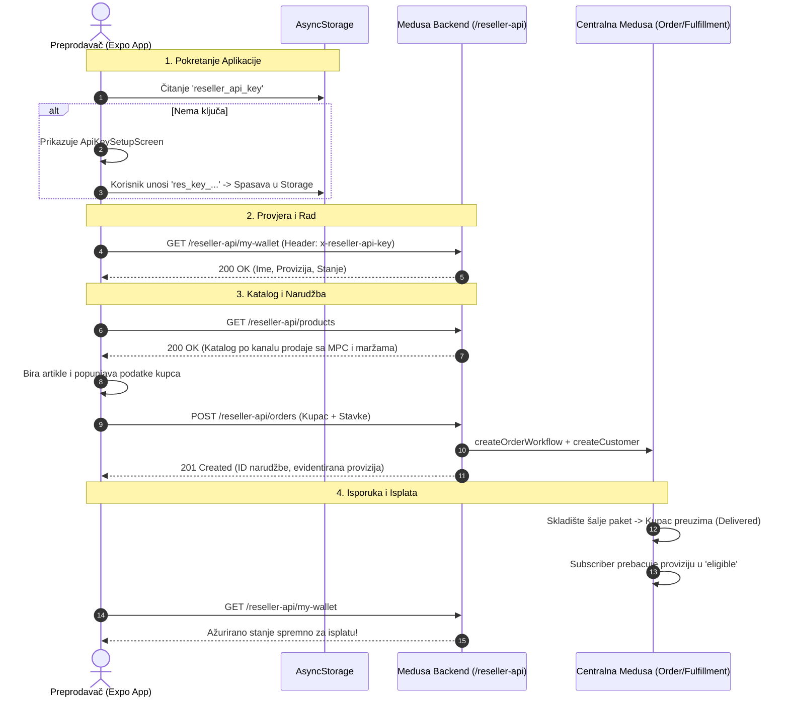

# Plan Implementacije: Medusa Reseller Expo Aplikacija (`medusa-reseller`)

Ovaj dokument detaljno specificira arhitekturu, tokove podataka, korisnički interfejs (ekrane) i plan izrade mobilne/tablet aplikacije za preprodavače i terenske agente (`medusa-reseller`), izrađene u **Expo / React Native** radnom okviru.

---

## 1. Analiza Dokumentacije i Postman Kolekcije

Na osnovu analize postojećeg koda u `medusa-backend` (`src/api/reseller-api`, `src/modules/reseller`) i Postman kolekcije (`docs/reseller_postman_collection.json` i `docs/reseller_api_documentation.md`), definisane su ključne karakteristike Reseller podsistema:

### 1.1. Autentifikacija
- **Bez korisničkog imena i lozinke**: Agenti nemaju klasični username/password nalog u Storefrontu.
- **API Ključ (`x-reseller-api-key`)**: Svaki preprodavač posjeduje jedinstveni ključ formata `res_key_xxxxxxxxxxxxxxxxxxxxxxxxxxxxxx`.
- **Validacija**: Svaki HTTP zahtjev prema ruti `/reseller-api/*` šalje zaglavlje:
  ```http
  x-reseller-api-key: res_key_xxxxxxxxxxxxxxxxxxxxxxxxxxxxxx
  ```
  Backend verifikuje postojanje i aktivan status agenta (`status === 'active'`). U suprotnom vraća `401 Unauthorized`.
- **Lokalno skladištenje**: Aplikacija čuva API ključ u perzistentnom skladištu (`@react-native-async-storage/async-storage`).

### 1.2. Dostupni API Endpointi
| Metoda | Endpoint | Namjena | Glavni Podaci |
| :--- | :--- | :--- | :--- |
| `GET` | `/reseller-api/products` | Katalog proizvoda sa maržama | Artikli, varijante, MPC (`retail_price`), nabavna cijena (`reseller_cost`), čista zarada agenta (`profit_margin`), filtrirano po `sales_channel_id`. |
| `POST` | `/reseller-api/orders` | Kreiranje narudžbe za kupca | Podaci o kupcu (ime, telefon, adresa, grad), stavke (variant_id, quantity), napomena za dostavu. Automatski kreira standardni Medusa kupac i Medusa narudžbu. |
| `GET` | `/reseller-api/my-orders` | Lista narudžbi agenta | Status pošiljke (`pending`, `shipped`, `delivered`, `returned`, `canceled`), status isplate provizije (`unearned`, `eligible`, `paid`), kontakt kupca. |
| `GET` | `/reseller-api/my-wallet` | Finansije & zarada agenta | Spremno za isplatu (`eligible_for_payout`), na čekanju (`pending_fulfillment`), već isplaćeno (`already_paid`), promet, historija isplata. |

---

## 2. Arhitektura Mobilne Aplikacije (`medusa-reseller`)

### 2.1. Tehnološki Stack
- **Framework:** Expo (React Native) sa TypeScriptom.
- **State Management:** `zustand` (lagan, reaktivan, bez boilerplate-a).
- **Perzistentno Skladište:** `@react-native-async-storage/async-storage` za spremanje:
  - `reseller_api_key`: API ključ agenta.
  - `backend_url`: URL Medusa backend servera (npr. `http://192.168.1.50:9000` ili produkcijska domena).
  - `offline_cached_catalog`: Keširani proizvodi za brzi prikaz.
  - `active_cart`: Radna narudžba/korpa u toku unosa.
- **Ikonice:** `lucide-react-native` (moderne, konzistentne vektorske ikonice).
- **Mreža & HTTP:** Tipizirani API klijent sa automatskim presretanjem grešaka (npr. automatsko vraćanje na ekran za unos ključa u slučaju `401 Unauthorized`).

### 2.2. Struktura Projekta (`medusa-reseller/src`)
```
medusa-reseller/
├── App.tsx                        # Glavna ulazna tačka, provjera API ključa, tab navigacija
├── app.json                       # Expo konfiguracija
├── package.json                   # Zavisnosti i skripte
├── tsconfig.json                  # TypeScript postavke
└── src/
    ├── api/
    │   ├── client.ts              # Axios/Fetch klijent koji lijepi x-reseller-api-key i base_url
    │   └── reseller-api.ts        # getProducts, createOrder, getMyOrders, getMyWallet
    ├── store/
    │   ├── auth-store.ts          # Čuvanje API ključa, profila agenta i backend URL-a u AsyncStorage
    │   ├── catalog-store.ts       # Proizvodi, pretraga, filtriranje
    │   ├── order-store.ts         # Radna korpa, podaci kupca, slanje narudžbe
    │   └── wallet-store.ts        # Finansije, lista narudžbi, osvježavanje
    ├── screens/
    │   ├── ApiKeySetupScreen.tsx  # Ekran za unos i validaciju API ključa (prvo pokretanje)
    │   ├── CatalogScreen.tsx      # Pregled asortimana sa istaknutim zaradama
    │   ├── ProductDetailModal.tsx # Detalji artikla, izbor veličine/boje i dodavanje u narudžbu
    │   ├── NewOrderScreen.tsx     # Forma kupca, pregled stavki i slanje narudžbe
    │   ├── OrdersListScreen.tsx   # Historija poslatih paketa i statusi dostave
    │   └── WalletScreen.tsx       # Finansijski bilans, provizije i postavke/odjava
    ├── components/
    │   ├── common/                # Header, Badge, Button, Input, Modal, Loader
    │   ├── catalog/               # ProductCard, PriceProfitTag, VariantSelector
    │   ├── order/                 # CartItemRow, CustomerForm
    │   └── wallet/                # StatCard, StatusPill, PayoutHistoryItem
    └── types/
        └── index.ts               # Tipovi: Reseller, Product, Variant, Order, Wallet
```

---

## 3. Detaljan Pregled Ekrana (Screens)

### Screen 1: Unos & Validacija API Ključa (`ApiKeySetupScreen`)
Ovaj ekran se prikazuje ukoliko aplikacija u `AsyncStorage` nema sačuvan važeći ključ, ili ukoliko korisnik odabere opciju "Promijeni API ključ / Odjava".

- **Elementi na ekranu:**
  - Logo i naslov: *Medusa Reseller Portal*.
  - Polje za unos **API Ključa** (npr. `res_key_...`) sa opcijom sakrivanja/prikaza karaktera ili lijepljenja iz međuspremnika (Paste dugme).
  - Polje za unos **Backend Server URL-a** (preddefinisano `http://localhost:9000` ili podesivi IP za lokalnu mrežu / produkciju).
  - Dugme **"Poveži se"**:
    - Šalje probni `GET /reseller-api/my-wallet` zahtjev sa unesenim podacima.
    - Ako je odgovor uspješan (`200 OK`):
      - Sprema `api_key` i `backend_url` u `AsyncStorage`.
      - Prikazuje pozdravnu poruku: *"Dobrodošli, [Ime Agenta]!"*.
      - Automatski preusmjerava na glavni meni (Katalog).
    - Ako je odgovor `401`: Prikazuje jasnu grešku *"Nevažeći API ključ ili je račun deaktiviran."*.
    - Ako je server nedostupan: Prikazuje grešku *"Nemoguće uspostaviti vezu sa serverom. Provjerite URL i internet konekciju."*.

---

### Screen 2: Katalog Proizvoda sa Provizijama (`CatalogScreen`)
Glavni radni ekran na kojem agent pregledava dostupne artikle i njihove cijene.

- **Ključne funkcionalnosti:**
  - **Automatski filter po prodajnom kanalu**: Agent vidi samo one artikle koji pripadaju njegovom prodajnom kanalu (automatski riješeno na backendu).
  - **Fokus na Profitnu Maržu**:
    - Prikaz **MPC (Maloprodajna cijena)**: Koliko kupac plaća (npr. `60.00 KM`).
    - Prikaz **Zarada / Provizija**: Vizuelno istaknuta zelena značka (npr. `+9.00 KM zarada`).
    - Prikaz **Nabavna cijena agenta**: Koliko se duguje sistemu (npr. `51.00 KM`).
  - **Pretraga & Filtriranje**: Brza pretraga po nazivu artikla ili SKU kodu.
  - **Odabir varijanti**: Ako proizvod ima više veličina/boja, agent jednim dodirom bira željenu varijantu.
  - **Dodavanje u narudžbu**: Dugme `+ Dodaj u narudžbu` sa brojačem količine.
  - **Plutajuća traka za korpu (Floating Cart Bar)**:
    - Prikazuje broj odabranih stavki, ukupan iznos za kupca i **ukupnu zaradu agenta** u realnom vremenu (npr. `3 artikla | MPC: 180 KM | Vaša zarada: +27 KM`).
    - Dodirom otvara ekran za unos narudžbe.

---

### Screen 3: Kreiranje Narudžbe za Kupca (`NewOrderScreen`)
Ekran kroz koji agent unosi podatke o kupcu i finalizira narudžbu koju šalje centralno skladište.

- **Sekcija 1: Pregled Odabranih Stavki**
  - Lista artikala sa slikom, odabranom veličinom/varijantom, količinom (+ / - dugmad) i cijenom.
  - Mogućnost uklanjanja artikla.
- **Sekcija 2: Podaci o Kupcu (Za Brzu Poštu)**
  - Ime i Prezime kupca *(obavezno polje)*.
  - Broj telefona *(obavezno polje)*.
  - Adresa stanovanja (ulica i broj) *(obavezno polje)*.
  - Grad i Poštanski broj *(obavezno polje)*.
  - Napomena za kurira / skladište (npr. *"Zvati kupca prije isporuke"*, *"Dostaviti poslije 16h"*).
- **Sekcija 3: Finansijski Rezime Narudžbe**
  - Ukupno za naplatu od kupca (otkupnina / MPC).
  - **Vaša čista zarada od ove narudžbe** (automatski izračunata provizija).
- **Dugme za slanje: "Potvrdi i Pošalji Narudžbu"**
  - Poziva `POST /reseller-api/orders`.
  - Prikazuje dijalog uspjeha sa brojem narudžbe (npr. `Narudžba #1002 uspješno kreirana!`).
  - Nudi opcije: *"Kreiraj novu narudžbu"* ili *"Pregledaj moje narudžbe"*.

---

### Screen 4: Moje Narudžbe i Statusi Pošiljki (`OrdersListScreen`)
Ekran na kojem agent u svakom trenutku prati stanje svojih poslatih paketa.

- **Pregled kartice narudžbe:**
  - Broj narudžbe i datum kreiranja.
  - Ime kupca, grad i adresa.
  - Dugme za **brzi poziv kupca telefonom** (otvara telefon na klik).
  - Ukupan iznos narudžbe i zarađena provizija.
- **Status dostave (`order_status`) sa vizuelnim bedževima:**
  - 🟡 `pending` – Zaprimljeno u skladištu / pakuje se.
  - 🔵 `shipped` – Poslano brzom poštom.
  - 🟢 `delivered` – Uručeno kupcu i naplaćeno!
  - 🔴 `returned` – Vraćena pošiljka.
  - ⚫ `canceled` – Otkazano.
- **Status isplate provizije (`payout_status`):**
  - ⏳ `unearned` – Čeka uručenje paketa.
  - 💰 `eligible` – Uručeno, spremno za isplatu novca agentu!
  - ✅ `paid` – Isplaćeno na račun agenta.
- **Interakcija:**
  - Pull-to-refresh (povuci prema dolje za osvježavanje statusa).
  - Filter po statusu (Sve, U toku, Uručeno, Isplaćeno).

---

### Screen 5: Moj Novčanik & Profil (`WalletScreen`)
Finansijska kontrolna tabla preprodavača.

- **Pregled stanja novčanika:**
  - **Spremno za isplatu (`eligible_for_payout`)**: Najvažniji podatak — novac koji agent može odmah podići/zatražiti jer su paketi uspješno uručeni kupcima.
  - **Na čekanju (`pending_fulfillment`)**: Potencijalna provizija za pakete koji su trenutno u tranzitu ili na pakovanju.
  - **Već isplaćeno (`already_paid`)**: Ukupan iznos provizija koje je admin do sada prebacio agentu.
  - **Ukupan ostvareni promet (`total_retail_sales`)**: Ukupna vrijednost prodatih artikala.
- **Historija isplata:**
  - Lista odobrenih isplata sa datumom, iznosom i brojem transakcije.
- **Podaci o Agentu:**
  - Ime i ID agenta.
  - Stopa provizije (npr. `15% po prodaji` ili fiksni iznos).
- **Postavke:**
  - Mogućnost promjene server URL-a.
  - Dugme **"Odjava / Promjena API ključa"** (briše ključ iz AsyncStorage i vraća na Setup ekran).

---

## 4. Tok Podataka i Sigurnost (Data Flow)



---

## 5. Koraci za Implementaciju u `medusa-reseller`

1. **Inicijalizacija i konfiguracija projekta (`package.json`, `app.json`, `tsconfig.json`)**:
   - Postavljanje Expo SDK zavisnosti (Expo, React Native, TypeScript, AsyncStorage, Lucide ikone, Zustand).
2. **Definisanje TypeScript tipova (`src/types/index.ts`)**:
   - Tipovi za `Reseller`, `Product`, `Variant`, `ResellerOrder`, `WalletInfo`.
3. **Mrežni sloj & Servis (`src/api/client.ts`, `src/api/reseller-api.ts`)**:
   - Centralizovano slanje `x-reseller-api-key` zaglavlja.
   - Prijateljske poruke grešaka i automatski hendling prekida konekcije.
4. **Upravljanje stanjem (`src/store/`)**:
   - `auth-store.ts`: Upravljanje API ključem i server adresom sa automatskim učitavanjem iz `AsyncStorage`.
   - `catalog-store.ts`: Keširanje i pretraga proizvoda.
   - `order-store.ts`: Upravljanje korpom i formom kupca.
   - `wallet-store.ts`: Osvježavanje narudžbi i stanja novčanika.
5. **Implementacija Ekrana (`src/screens/`)**:
   - `ApiKeySetupScreen`: Intuitivan ekran za povezivanje bez username/password.
   - `CatalogScreen`: Grid/lista kartica proizvoda sa naglašenom maržom.
   - `NewOrderScreen`: Čista i brza forma za naručivanje.
   - `OrdersListScreen`: Praćenje statusa dostave i provizija.
   - `WalletScreen`: Finansijski pregled i postavke.
6. **Krovna Navigacija (`App.tsx`)**:
   - Provjera stanja autentifikacije (ako nema ključa -> `ApiKeySetupScreen`, ako ima ključ -> Tab meni sa ikonicama: Katalog, Nova Narudžba, Narudžbe, Novčanik).
7. **Testiranje i Validacija**:
   - Provjera TypeScript tipova (`tsc --noEmit`).
   - Testiranje rada sa backendom preko cURL i Postman mock scenarija.
