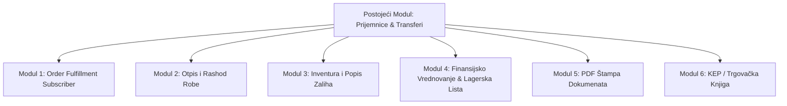

# 🚀 Plan Implementacije: Napredni Moduli za Robno-Materijalno Knjigovodstvo
### MedusaJS v2 — Proširenje Skladišnog Sistema

Ovaj dokument sadrži detaljan plan implementacije dodatnih 6 modula neophodnih za zaokruživanje cjelokupnog robno-materijalnog i skladišnog poslovanja.

---

## Pregled Faza i Modula

---

## 📌 MODUL 1: Automatsko Razduženje pri Prodaji (Order Fulfillment Subscriber) ✅ *(Implementirano)*

### Cilj
Kada se na webshopu realizuje narudžba i kreira **Fulfillment (otprema)**, skladište automatski evidentira izlaz robe i bilježi to u karton artikla (`StockMovement`), kako bi stanje na kartici odgovaralo stvarnom stanju.

### Implementirane komponente:
1. **Pretplatnik za otpremu**: `src/subscribers/order-fulfillment-created.ts`
   - Sluša `order.fulfillment_created`.
   - Idempotentno evidentira izlaz sa negativnim predznakom (`quantity_change: -X`).
   - Povezuje broj narudžbe (`ORD-1001`), ID fulfillmenta i skladišnu lokaciju.
2. **Pretplatnik za storno otpreme**: `src/subscribers/order-fulfillment-canceled.ts`
   - Sluša `order.fulfillment_canceled`.
   - Automatski vraća robu na stanje sa pozitivnim predznakom (`quantity_change: +X`) i oznakom storna.
3. **Admin UI prikaz**:
   - U `src/admin/routes/warehouse/page.tsx` i `src/admin/widgets/inventory-movement-widget.tsx` dodani bedževi:
     - 🟣 **Otprema Narudžbe (Izlaz)**
     - 🟠 **Storno / Povrat**
     - Oznaka broja narudžbe (npr. `🛒 ORD-1001`).

---

## 📌 MODUL 2: Zapisnik o Otpisu / Rashod Robe (Stock Write-Off & Scrap) ✅ *(Implementirano)*

### Cilj
Omogućiti formalno skidanje robe sa stanja u slučaju loma, oštećenja, isteka roka trajanja, kalo/rastura ili interne potrošnje kroz zakonski definisan dokument sa skladišnom komisijom.

### Implementirane komponente:
1. **DML Modeli podataka**:
   - `src/modules/warehouse/models/stock-write-off.ts` (Zaglavlje zapisnika, `RASH-YYYY-XXXX`, razlog, komisija, status).
   - `src/modules/warehouse/models/stock-write-off-item.ts` (Stavke sa količinom, nabavnom cijenom i opisom oštećenja).
2. **Baza podataka & Migracija**:
   - `Migration20261011191500.ts` primijenjena u PostgreSQL (tabele `stock_write_off` i `stock_write_off_item`).
3. **Workflows**:
   - `src/workflows/warehouse/create-stock-write-off.ts` (Kreiranje u `draft` statusu sa sekvencijalnim brojem).
   - `src/workflows/warehouse/post-stock-write-off.ts` (Skidanje zaliha preko `adjustInventoryLevelsStep` sa negativnim predznakom i upis u `StockMovement`).
4. **Admin REST API**:
   - `GET /admin/warehouse/write-offs`
   - `POST /admin/warehouse/write-offs`
   - `GET /admin/warehouse/write-offs/[id]`
   - `POST /admin/warehouse/write-offs/[id]/post`
5. **Zvanična A4 PDF Štampa Zapisnika**:
   - `src/admin/utils/print-document.ts` sa poljima za članove komisije, obrazloženjem i finansijskom rekapitulacijom.
6. **Admin UI**:
   - Četvrti tab u `src/admin/routes/warehouse/page.tsx` sa tabelom zapisnika, formom za novi zapisnik i modalom pregleda.

---

## 📌 MODUL 3: Inventura & Popis Zaliha (Stocktake & Reconciliation)

### Cilj
Omogućiti periodični (mjesečni ili godišnji) popis skladišta, automatski proračun viška i manjka, te formalno usklađivanje sistema sa stvarnim stanjem.

### Tok procesa (Workflow):
1. **Otvaranje Inventure**:
   - Bira se skladište (npr. Centralno Sarajevo).
   - Sistem bilježi **"Snapshot" trenutnog knjigovodstvenog stanja** za sve artikle.
2. **Fizičko brojanje**:
   - Popisna komisija/skladištari unose stvarno izbrojano stanje za svaki artikal.
3. **Automatski obračun razlika**:
   - `Razlika = Stvarno stanje - Knjigovodstveno stanje`.
   - Ako je `Razlika > 0` → **Višak**.
   - Ako je `Razlika < 0` → **Manjak**.
4. **Zaključenje inventure (Reconciliation Workflow)**:
   - Viškovi se automatski knjiže kao vanredni ulaz (`+X`).
   - Manjkovi se automatski knjiže kao otpis/manjak (`-X`).
   - Stanje zaliha u Medusi se usklađuje na tačno izbrojani iznos.
   - Generiše se konačni zapisnik o popisu sa finansijskim zbirom viškova i manjkova.

---

## 📌 MODUL 4: Finansijsko Vrednovanje Zaliha & Lagerska Lista (Costing & Stock Valuation)

### Cilj
Prikaz finansijske vrijednosti zaliha po magacinima i praćenje stvarne nabavne cijene.

### Ključne funkcije:
1. **Prosječna ponderisana nabavna cijena (WAC - Weighted Average Cost)**:
   - Svaki put kada se proknjiži nova prijemnica, ponovo se izračunava ponderisana nabavna cijena:
     $$\text{Nova Cijena} = \frac{(\text{Staro stanje} \times \text{Stara cijena}) + (\text{Nova količina} \times \text{Nova nabavna cijena})}{\text{Ukupno novo stanje}}$$
2. **Lagerska lista (Izvještaj po skladištima)**:
   - Prikaz tabele: SKU, Naziv, Stanje (kom), Ponderisana nabavna cijena (KM), **Ukupna vrijednost lagera (KM)**.
   - Sumarno po magacinu: Ukupna vrijednost robe u magacinu.
3. **API & Dashboard prikaz**:
   - `GET /admin/warehouse/reports/stock-valuation?location_id=...`

---

## 📌 MODUL 5: PDF Generator & Štampa Dokumenata (Document Printing)

### Cilj
Kreiranje standardizovanih PDF dokumenata spremnih za štampu, arhivu i potpise.

### Dokumenti koji se generišu:
1. **Prijemnica (Kalkulacija prijema)**:
   - Zaglavlje sa podacima firme, podaci o dobavljaču, broj fakture i datum.
   - Tabela sa artiklima: SKU, Naziv, Količina, Nabavna cijena, Iznos bez PDV-a.
   - Mjesto za potpis: *"Robu predao (Vozač/Dobavljač)"* i *"Robu zaprimio (Skladištar)"*.
2. **Međuskladišnica / Otpremnica**:
   - Prateći transportni dokument (Polazno skladište → Odredišno skladište).
   - Podaci o vozilu/vozaču, spisak artikala i količina.
   - Potpisi predaje i prijema.
3. **Popisna lista inventure**:
   - Obrazac za ručni unos brojanja na terenu.

### Tehnologija:
- `pdfmake` ili `@react-pdf/renderer` integrisan direktno u Medusa backend za generisanje PDF stream-a:
  - `GET /admin/warehouse/receipts/:id/pdf`
  - `GET /admin/warehouse/transfers/:id/pdf`

---

## 📌 MODUL 6: KEP / KEO Knjiga (Knjiga Evidencije Prometa)

### Cilj
Ispunjavanje zakonske obaveze vođenja trgovačke knjige na veliko/malo za tržišta u BiH i regiji.

### Struktura KEP Knjige:
- **Redni broj**
- **Datum knjiženja**
- **Opis knjiženja i broj dokumenta** (npr. *Prijemnica PRIJ-2026-0001 po računu dobavljača UF-142* ili *Otpremnica OTP-2026-005 po narudžbi ORD-1002*)
- **Zaduženje (Ulaz vrijednosti sa uračunatim porezom/maržom)**
- **Razduženje (Izlaz vrijednosti)**
- **Saldo (Ostatak vrijednosti robe na zalihama)**

### Funkcionalnost:
- Automatsko ažuriranje KEP knjige pri svakom proknjiženom ulazu i izlazu.
- Mogućnost izvoza u Excel (.xlsx) ili PDF za potrebe poreske inspekcije.

---

## 🗓️ Preporučeni Redoslijed Implementacije

| Korak | Modul | Zašto je važan u ovom redoslijedu |
|---|---|---|
| **1** | **Order Fulfillment Subscriber** | Zatvara krug sa webshopom: Ulaz robe je riješen, sada se rješava i automatski izlaz pri kupovini kupaca. |
| **2** | **Rashod & Otpis Robe (Write-off)** | Daje skladištarima legalan način da sklone oštećenu robu sa stanja bez ručnog brisanja. |
| **3** | **PDF Štampa Dokumenata** | Operativna potreba: magacioneri odmah mogu štampati i potpisivati prijemnice i međuskladišnice. |
| **4** | **Inventura (Popis Zaliha)** | Omogućava redovnu kontrolu skladišta i peglanje viškova/manjkova. |
| **5** | **WAC Vrednovanje & Lagerska lista** | Finansijski izvještaj o vrijednosti zaliha za vlasnika i računovodstvo. |
| **6** | **KEP Knjiga** | Zakonska usklađenost poslovanja. |
